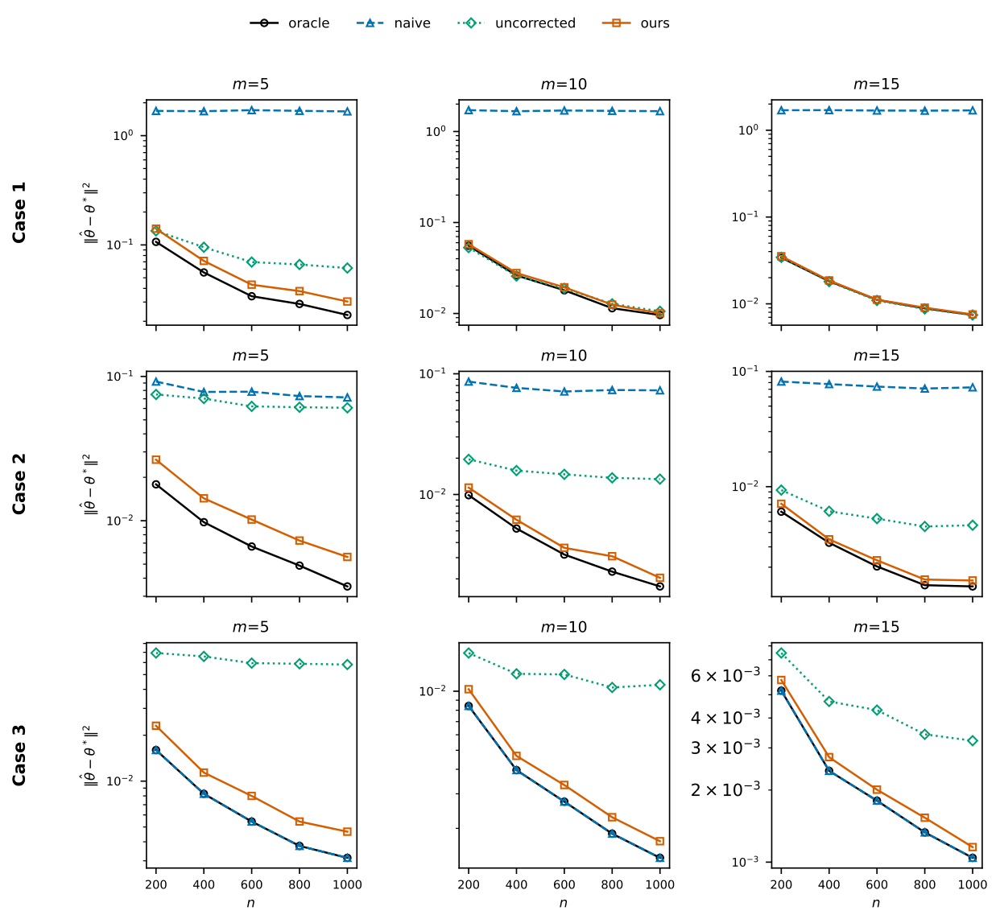
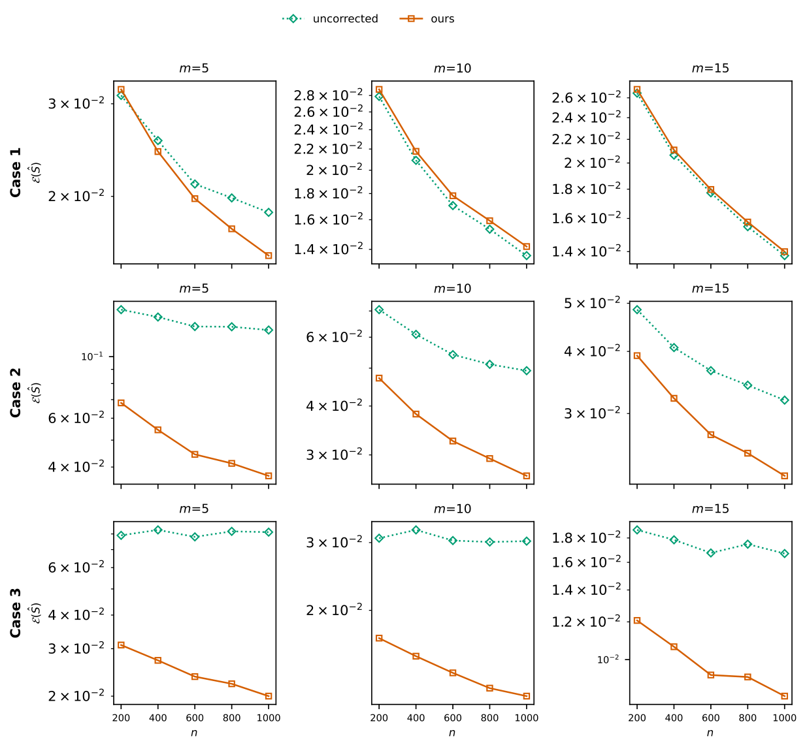
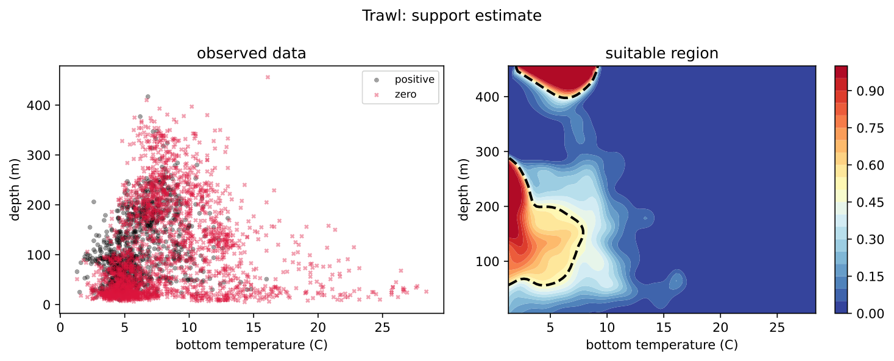
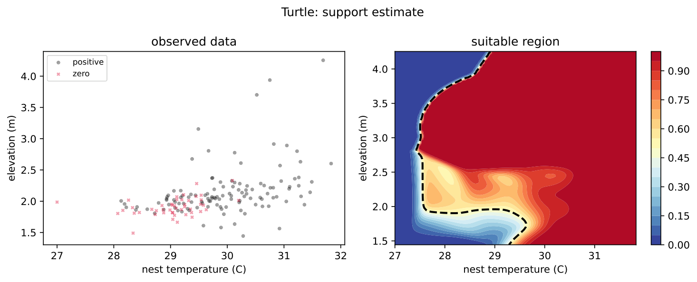

# Hybrid model for zero-inflated proportion data

Code for the numerical study of "A hybrid model for zero-inflated
proportion data". Model: `mY | X ~ Bin(m, sigma(X'theta) * I_S(X))`;
estimation by a debiased MLE for `theta` plus a kernel estimate of the
unsuitable region `S`, checked by a bottom-percent diagnostic.

## How to use

Python 3.9+ (numpy, scipy, pandas, matplotlib, imageio), R with
glmmTMB + gamlss, and `pip install tabicl==2.0.2`. Run from this
directory:

```bash
python simulation/run_simulation.py    # Table 2 + Figures C.1-C.2 + GIFs  (~8 min)
python real_data/run_experiment.py     # folds + R baselines               (~1 min)
python real_data/rerun_all.py          # Table 3 + Figures 1-2             (~1 min)
python real_data/verify_tabicl.py      # Table 3, TabICLv2 rows            (~2 min)
```

## Framework

```
data/            trawl.csv, turtle.csv          # the two analysis datasets
algorithm/       model, estimators, kernel_support, metrics
simulation/      dgp.py, run_simulation.py      # Table 2, Figures C.1-C.2
real_data/       load_data, run_experiment,     # Table 3, Figures 1-2
                 rerun_all, verify_tabicl
results/         figure/ (paper figures), temp/ (cached JSON, reproducible)
```

| Piece | Where |
|---|---|
| Debiased MLE (Newton) | `algorithm/estimators.py::fit_debiased` |
| Corrected outcome + NW support, tau = 1/2 | `algorithm/kernel_support.py` |
| Bandwidth: `(log n/n)^(1/3)` (simulation), LOO-CV (real data) | `kernel_support.py::bw_theory` / `nw_bw` |
| Model check (bottom 5/10/20% counts, out-of-fold) | `real_data/rerun_all.py` |

## Results

**Simulation** — n = 1000, 300 replications, m in {5,10,15}, tau = 1/2,
theoretical bandwidth (Table 2).

|  |  |
|---|---|
| *Left: mean squared error of the coefficient estimators vs M = nm; ours tracks the oracle and beats the uncorrected MLE wherever sigma is small (Cases 2-3).* | *Right: support error vs n; ours is 1.2-4.1 times more accurate in Cases 2-3.* |

**Real data** — five-fold cross-validation, same folds for every
method (Table 3).

|  |  |
|---|---|
| *Trawl (n = 3,367): the recovered cod habitat traces the thermal front; the check supports it (1, 8, 35 cod-containing hauls in the bottom 5/10/20%).* | *Turtle nests (n = 164): small sample, nearly linear boundary; best MAE on both datasets, AUC/MCC within one SE of TabICLv2.* |

| dataset | best MAE | ours | TabICLv2 |
|---|---|---|---|
| trawl  | ours .0442 | AUC .788 / MCC .347 | .793 / .358 |
| turtle | ours .2116 | AUC .837 / MCC .456 | .845 / .472 |

## Notes

- Seeds fixed (`config.sim_seed`, `default_rng(42)`): runs reproduce
  the cached JSON and the paper numbers bit-for-bit.
- All methods fit on fold-standardized covariates (R side included);
  bandwidth LOO-CV subsamples to at most 1,500 points; two stability
  guards (denominator floor 0.05, Newton ridge 1e-10) never activate.
- The three parametric baselines share one AUC by construction (same
  zero-indicator logit; no y = 1 in either dataset); their MAEs differ.
- `tabicl >= 2.0.0` ships TabICLv2 checkpoints; the paper uses 2.0.2.
